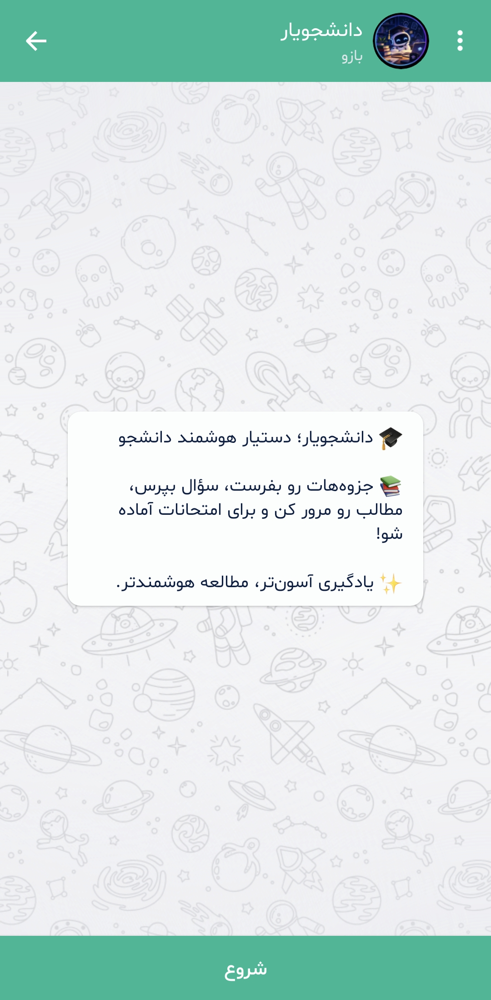
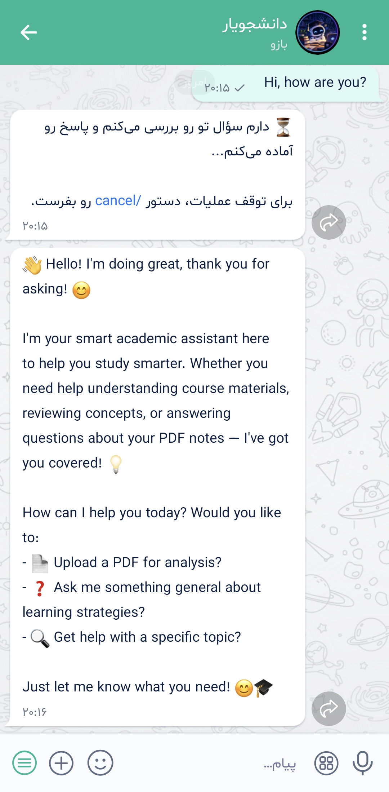
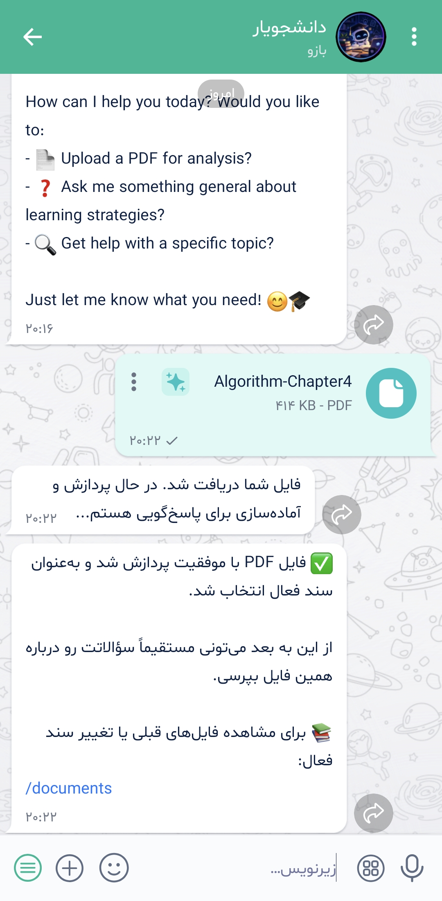
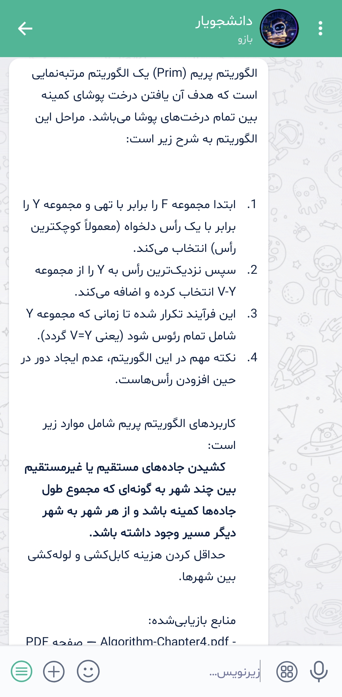
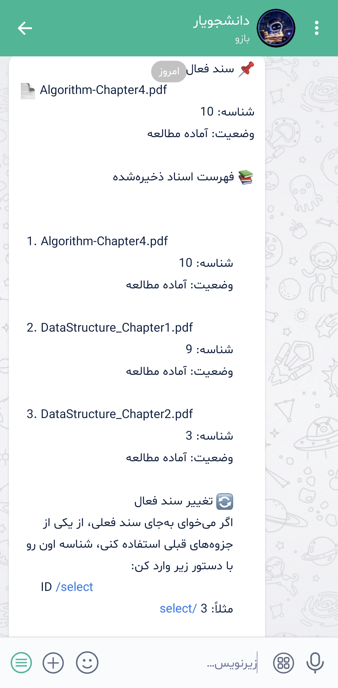

# Daneshjoyar — AI Study Assistant

**An AI-powered study assistant for Bale Messenger that answers questions from uploaded PDFs, supports contextual follow-up conversations, and manages study documents.**

Built with TypeScript, Node.js, PostgreSQL, pgvector, Ollama, and Qwen 3.5 9B.

## Screenshots

<p align="center">
  
  
  
  
  
</p>

## Features

- **PDF Management:** Upload, process, list, select, and delete study documents.
- **Document-Grounded Q&A:** Answer questions using relevant passages retrieved from uploaded PDFs.
- **Context-Aware Chat:** Use conversation history to handle follow-up questions.
- **Intelligent Query Routing:** Classify messages and choose between document-based answers and general chat.
- **Adaptive Retrieval:** Apply focused, multi-part, or broad retrieval strategies based on the question.
- **Long-Document Summarization:** Summarize document batches and combine their results into a consolidated answer.
- **Source References:** Include document names and PDF page references in document-based answers.

## Technical Highlights

| Component          | Implementation                                                          |
| ------------------ | ----------------------------------------------------------------------- |
| Backend            | Node.js, TypeScript                                                     |
| Messaging          | Bale Bot API                                                            |
| Database           | PostgreSQL                                                              |
| Vector search      | pgvector                                                                |
| Embeddings         | BGE-M3                                                                  |
| LLM inference      | Ollama, Qwen 3.5 9B                                                     |
| Document pipeline  | PDF ingestion, text chunking, embedding generation                      |
| Retrieval          | Vector similarity search, relevance filtering, adaptive retrieval modes |
| Conversation state | Persistent message history and active-document selection                |
| Deployment         | Docker                                                                  |

## Architecture & Implementation

1. **Document ingestion:** Receive PDFs through Bale, download them, extract their contents, split text into chunks, and generate embeddings.
2. **Vector storage:** Store document chunks and metadata in PostgreSQL with pgvector for similarity-based retrieval.
3. **Message classification:** Route incoming messages to document-based retrieval or general conversation.
4. **Context management:** Use recent conversation history to support follow-up questions and contextual responses.
5. **Adaptive retrieval:** Handle focused questions, multi-part questions, and broad requests using different retrieval strategies.
6. **Answer generation:** Provide relevant document context to the LLM and generate answers with source references where available.
7. **Document management:** Maintain user-specific documents and the currently selected document.

## Technology Stack

`TypeScript` · `Node.js` · `PostgreSQL` · `pgvector` · `BGE-M3` · `Ollama` · `Qwen 3.5 9B` · `Docker` · `Bale Bot API`

## Project Status

An actively developed personal project exploring retrieval-augmented generation (RAG), context-aware conversations, document retrieval strategies, and LLM-powered study assistance.

## Project structure

```
src/
  main.ts            entry point: health endpoint + Bale polling
  config.ts          all env vars and tunables (models, timeouts, chunk size, thresholds)
  logger.ts          leveled logger (LOG_LEVEL=debug|info|warn|error)
  errors.ts          typed errors and user-facing error text
  bale.ts            Bale API client (messages, updates, file download)
  bot/               polling loop, update dispatcher, commands, Persian copy
  chat/              message pipeline (chatService) and PDF upload flow
  llm/               Ollama client (chat + embeddings) and prompts
  rag/               router, ingest, chunking, retrieval, answer generation
  db/                one module per table; all SQL lives here
tests/               vitest unit tests (`npm test`)
```
